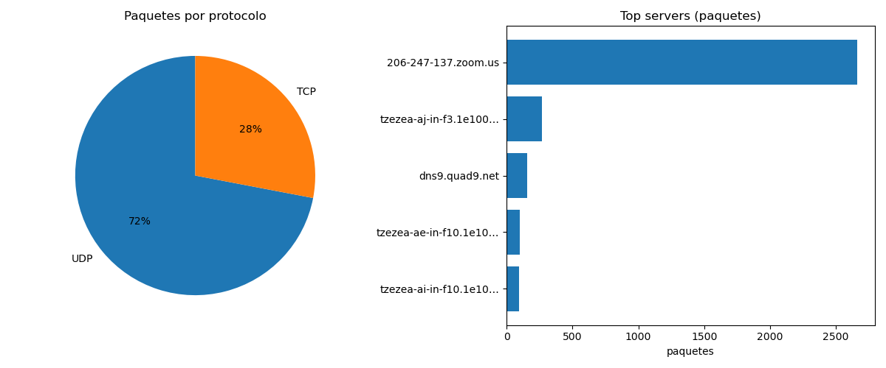

# packet-sniffer



Sniffer de paquetes educativo, hecho con Python y scapy. Captura el tráfico de la red, lo analiza y arma un resumen con estadísticas, guarda la captura para Wireshark y genera un gráfico.

Proyecto de aprendizaje para entender cómo funciona TCP/IP viéndolo pasar de verdad.

## Uso ético y legal

Esta herramienta captura TODO el tráfico que pasa por la placa de red, incluido el que no es tuyo. Usala **solo en tu propia red o tu propia máquina**.

Capturar tráfico de redes ajenas (la facu, el trabajo, un café, la red de un vecino) es ilegal en Argentina y en casi todo el mundo, por más que sea "para aprender". No lo hagas.

## Qué hace

- Captura el tráfico durante unos segundos
- Resume por protocolo (TCP / UDP / ICMP)
- Separa los dispositivos de tu red de los servers de internet
- Resuelve el nombre de cada server (reverse DNS)
- Detecta los servicios usados (HTTPS, DNS, etc.) ignorando los puertos efímeros
- Cuenta las conexiones distintas
- Avisa de tráfico sin cifrar (HTTP, FTP, Telnet) y de posibles escaneos de puertos
- Guarda la captura en `.pcap` para abrir en Wireshark
- Genera un gráfico `.png` (protocolos y top servers)

## Requisitos

- Python 3
- scapy y matplotlib

En Ubuntu / Debian, lo más simple (porque el sniffer corre con sudo):

```bash
sudo apt install python3-scapy python3-matplotlib
```

## Uso

```bash
sudo python3 sniffer.py
```

Captura 15 segundos de todo el tráfico. Se configura con argumentos (no hace falta editar el archivo):

```bash
sudo python3 sniffer.py -s 30              # capturar 30 segundos
sudo python3 sniffer.py -f tcp             # solo TCP
sudo python3 sniffer.py -s 60 -f "port 53" # 60 segundos, solo DNS
sudo python3 sniffer.py --help             # ver todas las opciones
```

| Opción | Qué hace |
|--------|----------|
| `-s`, `--segundos` | Cuántos segundos capturar (default: 15) |
| `-i`, `--interfaz` | Placa de red, ej: `wlan0` (default: la del sistema) |
| `-f`, `--filtro` | Filtro BPF, ej: `tcp`, `port 53`, `not port 443` |
| `--escaneo` | Puertos distintos entre dos IPs para alertar escaneo (default: 15) |

Mientras corre, generá tráfico: abrí una web o tirá un `ping` desde otra terminal.

Cada corrida deja dos archivos en la carpeta: `captura_FECHA.pcap` y `grafico_FECHA.png`. Ambos están en `.gitignore` para no subir tráfico real al repo.

## Ejemplo de salida

```
========================================
RESUMEN (15 s)
========================================

Paquetes capturados: 272

Por protocolo:
  TCP   188
  UDP   81

Servers de internet:
  206.247.137.132   2663  206-247-137.zoom.us
  9.9.9.9            154  dns9.quad9.net

Servicios mas usados:
    443 HTTPS     101
     80 HTTP       23

Conexiones distintas: 46

[!] Trafico SIN CIFRAR detectado:
    HTTP    con 66.203.126.146  (2 paq)  ->  usá HTTPS
```

## Limitaciones

Los detectores de escaneo y de tráfico sin cifrar son heurísticas simples, no un IDS profesional. Pueden dar falsos positivos (algo legítimo que toca muchos puertos) o perderse un escaneo lento hecho a propósito para no pasar el umbral. Sirven para aprender el concepto, no para defender una red en producción.

## Roadmap

- [x] v1: capturar y mostrar paquetes
- [x] v2: contar y analizar (por protocolo, top de IPs, conexiones)
- [x] v3: resolver nombres de servers y limpiar los puertos efímeros
- [x] v4: guardar a `.pcap` y generar gráfico
- [x] v5: alertas de seguridad — tráfico sin cifrar, detección de escaneos, filtro por protocolo
- [x] v6: argumentos por línea de comando y licencia MIT
